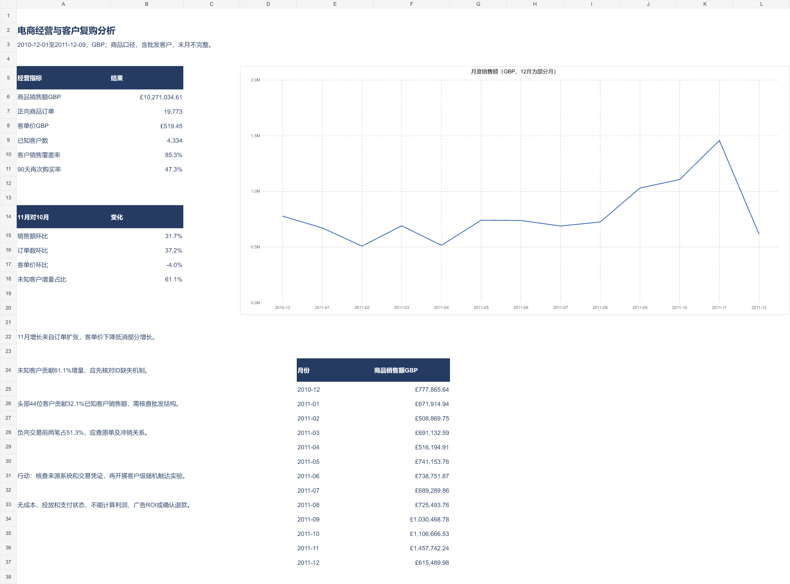

# 电商经营增长与客户复购分析

基于 **UCI Online Retail 真实交易数据**的独立公开数据项目。使用 Python、SQL 和 Excel，从指标定义、数据质量核查到经营拆解、客户复购和策略验证设计，完成可复现分析。

> 核心发现：2011年11月销售额增长31.7%，但客户ID缺失交易贡献了61.1%的增量。应先核查增长的客户身份，再判断客户运营效果。

## 分析结果

|指标|结果|解释|
|---|---:|---|
|原始交易明细|541,909行|2010-12-01至2011-12-09|
|正向商品销售额|£10,271,034.61|商品发票行口径，并非核实到账收入|
|正向商品订单|19,773单|发票号去重|
|11月销售额环比|+31.7%|订单数+37.2%，客单价−4.0%|
|未知客户交易增量占比|61.1%|客户ID缺失，不能认定为新客|
|完整90天再次购买率|47.3%|1,593 / 3,368名合格客户|



## 项目背景与方法

业务问题是：最近完整月销售增长来自哪里？哪些客户及商品解释了变化？客户复购有哪些可验证的运营机会？

1. **数据治理**：保留原始数据及SHA-256记录；区分商品销售、负向交易、非商品项目和非正价格；缺失客户ID交易仍计入经营盘，但不进入客户指标分母。完全相同的重复候选保留基准，另外进行去重敏感性分析。
2. **经营拆解**：采用“销售额＝订单数×客单价”的固定顺序恒等分解，继续追踪客户身份与商品的销售增量贡献。
3. **客户分析**：完整90天观察窗再次购买率、首次观察月份Cohort自然月留存、基于最近购买与订单次数的可解释分群。
4. **验证与交付**：SQL/Python独立金额核对、90天复购独立SQL核对、增量加总检查；交付报告、Excel和离线HTML看板及客户级随机触达实验设计。

## 查看成果

- [完整经营报告](results/分析报告.md)：业务判断、实数证据、指标定义、建议和限制。
- [Excel经营看板](results/经营分析看板.xlsx)：下载后打开，包含公式、图表、月度拆解和留存矩阵。
- [离线HTML看板](results/dashboard.html)：下载整个仓库后在浏览器打开，可切换指标及部分月份。GitHub文件页不会直接运行HTML。
- [指标与数据字典](docs/指标与数据字典.md) · [业务分析与验证设计](docs/业务分析与验证设计.md)
- [SQL查询](sql/analysis.sql) · [验证记录](results/validation.json)

## 技术栈

Python（pandas、NumPy）、SQL（SQLite）、Excel、HTML/CSS/JavaScript、Cohort与指标分解。Excel构建器使用 `@oai/artifact-tool`；Python分析与HTML报告不依赖此工具。

## 数据来源

- **发布平台**：[UCI Machine Learning Repository — Online Retail](https://archive.ics.uci.edu/dataset/352/online+retail)
- **作者**：Daqing Chen；**DOI**：[10.24432/C5BW33](https://doi.org/10.24432/C5BW33)
- **业务**：英国非门店礼品零售商历史交易，包含批发客户。
- **官方原始文件**：[下载ZIP](https://archive.ics.uci.edu/static/public/352/online+retail.zip)
- **本次分析来源记录**：[manifest](data/raw/manifest.json) · [UCI元信息](data/raw/uci_metadata.json)

仓库保留聚合分析与来源信息；原始Excel、ZIP、大型SQLite及逐客户明细由脚本生成，不纳入Git。全部分析使用真实交易，没有生成模拟数据。自行计算的哈希用于检测文件变化，不是UCI数字签名。UCI数据页面标注数据许可为 [CC BY 4.0](https://creativecommons.org/licenses/by/4.0/)，原始数据与衍生成果应保留来源及署名。

## 复现

Python 3.10+，在仓库根目录执行：

```bash
python -m venv .venv
# Windows: .venv\Scripts\activate
# macOS/Linux: source .venv/bin/activate
python -m pip install -r requirements.txt
python src/download_data.py
python src/analyze.py
python src/enrich_analysis.py
python src/finalize_report.py
```

如果已从官方手动下载ZIP：

```bash
python src/download_data.py --local-zip "下载文件路径/online+retail.zip"
```

Windows在首次安装依赖与下载数据后，也可双击 `run_analysis.cmd`。输出位于 `results/`。所有Python路径按项目所在位置解析。`analyze.py`先生成基础结果，`enrich_analysis.py`补充归因和独立验证，`finalize_report.py`生成最终报告与HTML；最后两步应按顺序完成。

Excel已提供成品。Python重跑会刷新CSV、数据库、报告和HTML，**不会刷新Excel**；需要可用的 `@oai/artifact-tool` Node运行环境，再执行 `node src/build_dashboard.mjs "仓库绝对路径"` 重建。此可选依赖未包含在Python requirements中。

## 检查和结论边界

已经核对源文件哈希、字段、行数、日期、清洗分区、SQL/Python销售及负向金额、客户金额、90天再次购买人数与增量分解。金额容差0.01GBP，计数精确一致。Excel做过公式错误扫描、输入变更联动、导出缓存及视觉检查；未在Microsoft Excel原生程序运行。HTML已通过浏览器交互与视觉复核。

- 2011年12月只有截至9日的数据，不参加完整月环比和自然月留存比较。
- 首次观察购买不等于真实新客；客户指标仅覆盖可识别客户，含批发业务，不能直接外推全体消费者。
- 负向记账记录不等于核实退款。无成本、流量、广告、库存或支付状态，不计算利润、ROI或真实退款率。
- 经营分解是描述性定位，不能推出促销因果效果。客户触达实验仅为方案，未实施，不声称推动企业业绩增长。

本项目为独立公开数据分析作品，不是企业实习或商业委托项目。
